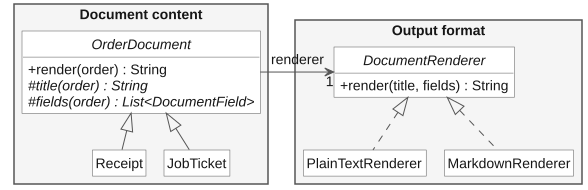
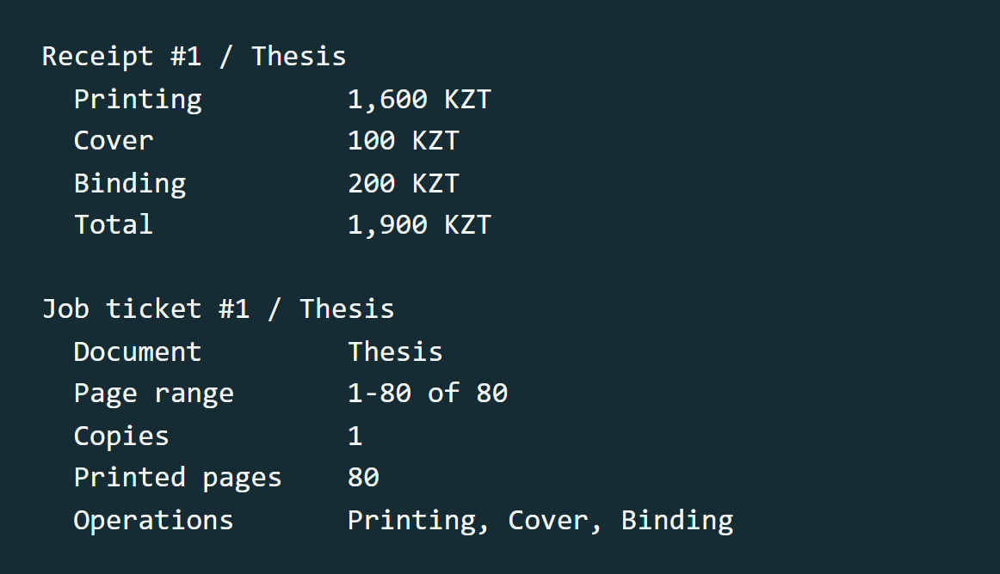
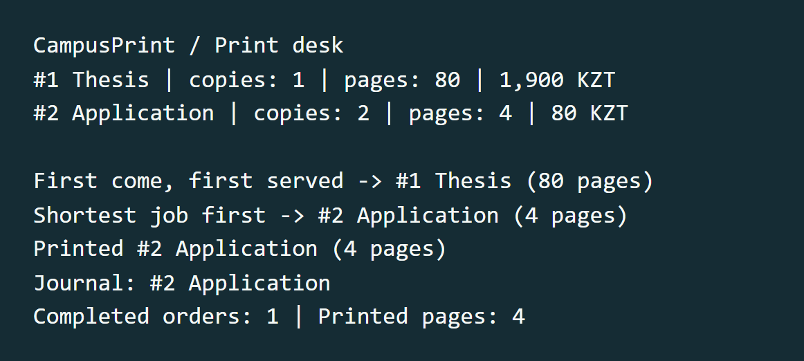
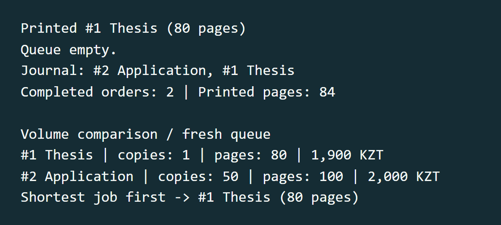

# CampusPrint

University print desk simulator

**Amir Baiseitov** · SE-2505<br>
Software Design Patterns · Final project defense · November 2026

### Introduction

Two students bring work to a print desk. One wants a bound thesis. The other needs two copies of a short application. The operator must quote each order, choose a job to print and record what actually finished. CampusPrint models those decisions in one Java application.

The interesting case occurs when the operator changes the queue policy after accepting both jobs. Arrival order favors the thesis. Shortest job first favors the application, until the requested copy count makes it the larger job. The decision depends on the same print volume used for billing and statistics.

### The reference orders

| Order | Selected pages | Copies | Services | Amount |
| --- | --- | --- | --- | ---: |
| 1 · Thesis | 1–80 of 80 | 1 | Print, cover, bind | 1,900 KZT |
| 2 · Application | 2–3 of 5 | 2 | Print | 80 KZT |

### Scope and contribution

I implemented the six course patterns, integrated them in a single print workflow and prepared its verification cases. The simulation runs in one process with an in-memory queue. A successful printer call writes to the terminal. An injected paper jam exercises the failure path. The program calculates every quoted amount, queue selection and completion count.

## Architecture

The two gray boxes connect the six pattern groups. `Main` assembles the demonstration. `PrintOrder` pairs a numbered job with its pricing services. Both document types read that same order.


Follow the **queue** relationship to see what the operator schedules. Follow **service** to find where a charge originates. Follow **read** from Bridge to see how that charge reaches the customer.

## Building and pricing an order

### Builder

`PrintJob.Builder` starts with a document name and its total page count. The full document and one copy are the defaults. Range and copy settings remain private to the builder until `build()` validates them and takes an immutable snapshot. An invalid job cannot enter the queue.

```java
PrintJob application = new PrintJob.Builder("Application", 5)
        .range(2, 3)
        .copies(2)
        .build();
```

Both endpoints count. Pages 2 through 3 produce two pages per copy, or four printed pages for this order. The builder checks the multiplication in 64-bit arithmetic before accepting a volume that must fit a Java `int`. This keeps an oversized batch from appearing to cost zero or jumping ahead in the queue.

### Decorator

The operator chooses finishing services at acceptance. Each decorator wraps a `PrintService`, preserves its line items and appends one charge of its own. The chain rejects a second occurrence of the same finish.

```java
PrintJob thesis = new PrintJob.Builder("Thesis", 80).build();
PrintOrder order = center.acceptOrder(thesis,
        new Binding(new Cover(new BasicPrinting())));
```

| Thesis receipt | Calculation | Amount |
| --- | --- | ---: |
| Printing | 80 printed pages × 20 KZT | 1,600 KZT |
| Cover | 1 copy × 100 KZT | 100 KZT |
| Binding | 1 copy × 200 KZT | 200 KZT |
| **Total** | **Sum of the line items** | **1,900 KZT** |

The production ticket takes its operation names from the same line items. Choosing binding once therefore supplies both the price on the receipt and the instruction at the printer. Charges use whole tenge stored in a Java `long`.

## Scheduling and completion

**Strategy.** `FirstComeFirstServed` selects the queue head. `ShortestJobFirst` scans for the smallest print volume and keeps the earlier entry on a tie. Preview and print call the same selection method. Switching policies preserves arrival order.

**Facade.** One call to `PrintCenter.printNext()` selects the job, runs the printer, removes the completed order and publishes its completion. A paper jam interrupts this sequence before removal. An operator can clear the fault and retry that same order.


**Observer.** The journal records the order number and title. Statistics count completed jobs and pages. The center snapshots the subscriber list before dispatch, so a subscription change during a callback applies to the next event. Each registered observer receives one call for the current event.

## Documents and output formats

**Bridge.** The customer needs an itemized price. The operator needs the range, copies and finishing instructions. `Receipt` and `JobTicket` choose the fields. Their shared base class holds a `DocumentRenderer` and passes it a title and those fields.



The text renderer aligns labels and values. The Markdown renderer emits a two-column table and escapes table delimiters in input. The demo renders both documents in both formats for order 1. Its price and finishing services agree across all four outputs.



## Demonstration results

### Switching policy on a live queue

FIFO previews order 1, which arrived first. The operator switches to shortest job first. The four-page application prints next. Its completion reaches both subscribers while the thesis remains pending.



### Changing the order quantity

After the thesis prints, the empty-queue request leaves the totals at two orders and 84 pages. The next comparison starts with a fresh queue. Fifty copies of the two-page application now require 100 pages, so the 80-page thesis wins under the same shortest-job policy.



To change the comparison at the defense, run `java -cp out campusprint.Main 10`. Ten copies require 20 pages and cost 400 KZT. At 40 copies the volumes tie, so arrival order decides.

## Verification and conclusions

### Verification

The project compiles against the Java 17 API. The executable checks use the standard library and throw an assertion error on a mismatch. Run `java -cp out campusprint.PrintCenterChecks` after compilation.

| Case | Expected and observed result |
| --- | --- |
| Invalid job | Reject a blank title, zero copies, an inverted range and an out-of-bounds range. |
| Volume limit | Reject 65,536 pages × 65,536 copies before accepting the job. Large valid charges and cumulative page totals retain their full value. |
| Finishing | Three copies of four pages with two finishes total 1,140 KZT. Reject a duplicate cover even when binding is nested between the two covers. |
| Scheduling | On a tie the earlier job wins. Preview leaves both entries in place. |
| Paper jam and retry | The queue and journal retain their pre-print state. After recovery, each job completes once. |
| Subscription changes | A subscriber can remove itself during delivery. The next subscriber still sees that print. A newly registered subscriber starts with the next print. |
| Document formatting | A title containing a vertical bar and a line break stays in one Markdown table cell. |

### Conclusion

A single order carries its validated page range, copy count and chosen services from acceptance through billing, scheduling and reporting. In the reference run the print center completes 84 pages in two jobs. Raising the application quantity reverses the scheduling decision without any change to the algorithm.

### Future work

A persistent queue would let an operator resume outstanding work after a restart. It would need a durable order identifier and an explicit recovery policy for a job interrupted during printing. A further extension would route orders to printers with different finishing capabilities. The operator's ticket already identifies the required operations.

### Java source

The PDF appendix contains the complete application listing from `src/campusprint`. The source ZIP also includes the executable regression checks, the editable UML and the build instructions.
