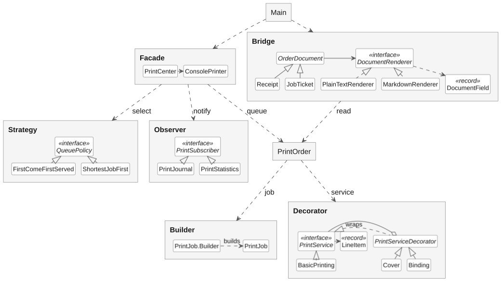
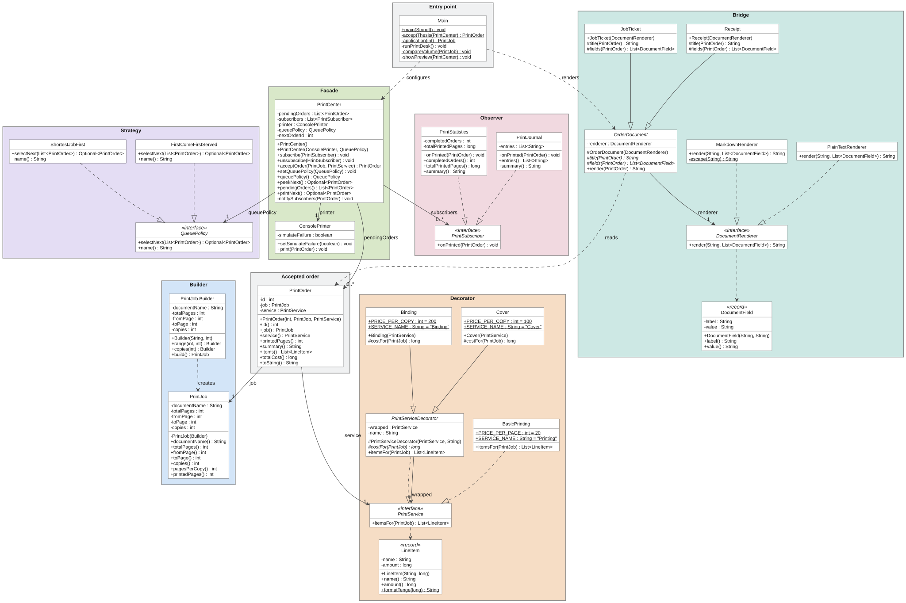
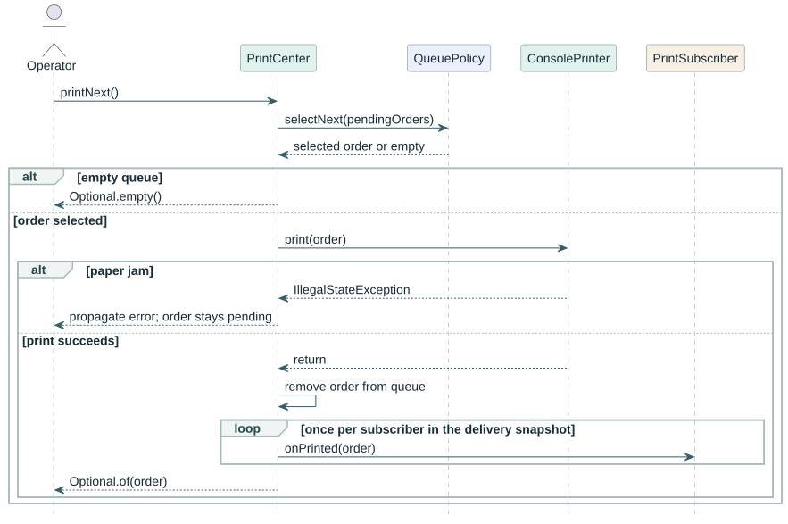
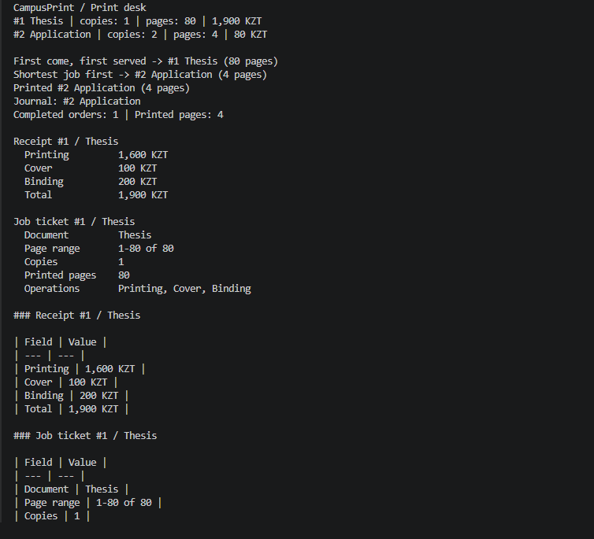
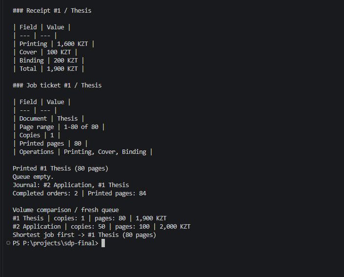

# CampusPrint

University print desk simulator<br>
Software Design Patterns · Final project defense<br>
Amir Baiseitov · SE-2505 · November 2026

## 1. Introduction

A university print desk takes orders for individual pages or whole documents. A student may also ask for several copies, a cover or binding. The operator needs to know what to charge, which order to print next and what work has actually finished.

I developed CampusPrint as an individual Java project. My aim was to use six design patterns to answer those questions in one console application. The program simulates a single printer. It calculates prices and page counts, maintains a queue in memory and records completed jobs. It can also simulate a paper jam.

## 2. Main body

### 2.1 The reference orders

The operator first accepts a thesis and then an application. Page ranges include both endpoints. Printing costs 20 KZT per printed page, a cover costs 100 KZT per copy, and binding costs 200 KZT per copy.

| Order | Pages selected | Copies | Printed pages | Services | Total |
| --- | --- | ---: | ---: | --- | ---: |
| 1. Thesis | 1-80 of 80 | 1 | 80 | Printing, cover, binding | 1,900 KZT |
| 2. Application | 2-3 of 5 | 2 | 4 | Printing | 80 KZT |

The application is a useful case for checking the design. Selecting pages 2 and 3 in two copies produces four printed pages. Billing uses that number to calculate 80 KZT. The shortest-job policy uses it to select the application. Once the printer finishes, the statistics subscriber adds exactly four pages. All three operations obtain the volume from the same `PrintJob`.

The thesis illustrates a different connection. Adding binding increases the price on the customer's receipt by 200 KZT and adds "Binding" to the operator's job ticket. Both documents use the services attached to the accepted order.

---

### 2.2 Pattern overview



**Builder.** The thesis uses the defaults of one copy and the whole document. The application sets both options. When `build()` runs, it checks the final range and copy count together. It rejects pages outside the document, a nonpositive quantity or a total volume exceeding the per-job page limit. Pricing and scheduling then read the same immutable job.

```java
return new PrintJob.Builder("Application", 5).range(2, 3).copies(copies).build();
```

**Decorator.** `BasicPrinting` creates the charge for the printed pages. `Cover` and `Binding` each wrap another `PrintService`, retain its line items and add one finishing charge per copy. For the thesis the calculation is 80 × 20 + 100 + 200 = 1,900 KZT. A second cover is rejected even if another decorator sits between the two covers.

```java
return center.acceptOrder(thesis, new Binding(new Cover(new BasicPrinting())));
```

---

### 2.3 Implementation class diagram



Visibility is marked with `+` (public), `-` (private) and `#` (protected). Underlining marks a static member. Parameter types appear inside parentheses. Hollow triangles point to a superclass or implemented interface. Solid associations show stored references, including the pending orders and subscribers held by PrintCenter. Method signatures also show types used as arguments and results.

---

### 2.4 Selecting and completing a job

**Strategy.** `PrintCenter.peekNext()` asks the active `QueuePolicy` to select from the pending orders in arrival order. FIFO takes the first entry. Shortest job first compares printed page counts, including copies. It replaces its candidate only for a strictly smaller job, so the earlier order wins a tie. Finishing time is outside this estimate. Switching policies leaves both jobs pending.

**Facade.** The operator calls `PrintCenter.printNext()`. The center uses the same preview to select the order, sends it to the printer and removes it only after printing succeeds. If the printer throws a paper-jam exception, the order remains pending for a retry.



**Observer.** `PrintJournal` records the completed order's number and title. `PrintStatistics` increments the job and page totals. Both receive the order through `onPrinted(order)`. The center takes a snapshot of the subscriber list so an observer can unsubscribe during its callback without causing another observer to miss that print.

The retry check uses two ten-page orders, Handout and Worksheet. With a simulated jam on Handout, both remain in the queue and the journal is empty. After the fault is cleared, the journal records Handout followed by Worksheet and the counter reads 20 pages. This checks the point at which the facade publishes completion.

---

### 2.5 Receipt and job ticket

**Bridge.** The customer needs an itemized bill. The operator needs a page range, copy count and finishing instructions. `Receipt` and `JobTicket` choose the relevant fields from the same `PrintOrder`. Their base class, `OrderDocument`, passes the title and fields to its `DocumentRenderer`.

The text renderer aligns labels and values. The Markdown renderer puts the same fields into a table and escapes vertical bars in field values. A receipt pairs each service with its charge. A job ticket lists the same services as operations and gives the operator the range and copy count. Each renderer receives just a title and labeled fields, so it can format either document.



---

### 2.6 Application run

From the project root, compile and run the demonstration with JDK 17 or later.

```text
javac --release 17 -encoding UTF-8 -d out -sourcepath src src/campusprint/Main.java
java -cp out campusprint.Main
```



To test the selection yourself, run `java -cp out campusprint.Main 39` and then repeat with `40`. This argument changes the copy count only in the fresh queue. At 39 copies, two pages per copy give the application 78 pages and it wins the preview. At 40 copies both jobs have 80 pages, so the earlier thesis wins. Both orders remain pending in this comparison.

---

### 2.7 Verification

The regression checks run independently of the demonstration. They throw an assertion error if an observed value differs from the expected value.

```text
javac --release 17 -encoding UTF-8 -cp out -d out test/campusprint/PrintCenterChecks.java
java -cp out campusprint.PrintCenterChecks
```

| Check | Observed result |
| --- | --- |
| Invalid range or copy count | An inverted range, a range beyond the document and zero copies are rejected before acceptance. |
| Numeric limits | A batch of 65,536 pages × 65,536 copies is rejected. Prices and cumulative page totals above the 32-bit limit retain their value. |
| Combined services | Three copies of four pages with both finishes cost 1,140 KZT. Reading the quote twice preserves the original line items. |
| Jam, recovery and empty queue | A failed print leaves the queue, journal and statistics unchanged. After recovery both jobs complete once. An empty-queue request adds no completion. |
| Subscription change | A subscriber removes itself during a callback. The remaining subscriber still receives the event. A new subscriber starts on the next event. |
| Document content and format | One test renderer receives two different field lists for the same order. The receipt totals 320 KZT and the ticket specifies six pages and a cover. A title containing a vertical bar and a line break stays in one Markdown table cell. |
| Live queue selection | At 10 copies the comparison previews the 20-page application and quotes 400 KZT. At the default 50 copies it previews the 80-page thesis. |

## 3. Conclusion

CampusPrint applies all six patterns to the same orders. In the reference run the four-page application prints first under shortest job first, the journal records order 2, and the page counter increases by four. The thesis then prints with the same finishing services shown on its receipt. The failed-print check also confirms that accepting an order and completing it are separate events.

## 4. Future work

The queue currently lasts for one program run. Persisting accepted and completed orders would allow recovery after a restart. The recovery design would need to distinguish a pending job from a job that reached the printer just before the application stopped. A second extension would add a maximum waiting time to the shortest-job policy so that repeated small jobs cannot postpone a long thesis indefinitely.

---

## 5. Java source code

The listing contains all application files under `src/campusprint`. The accompanying ZIP also includes the regression checks in `test/campusprint`.
